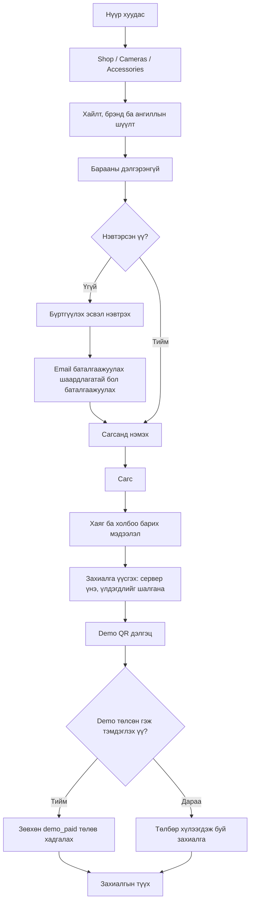
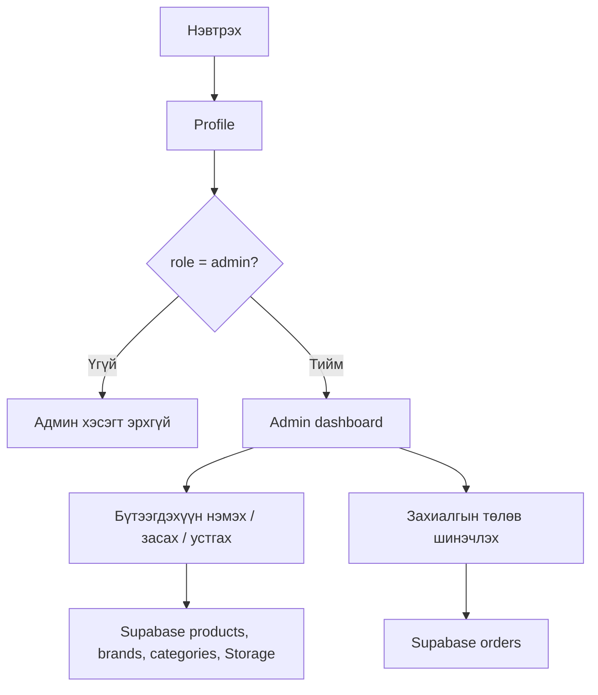
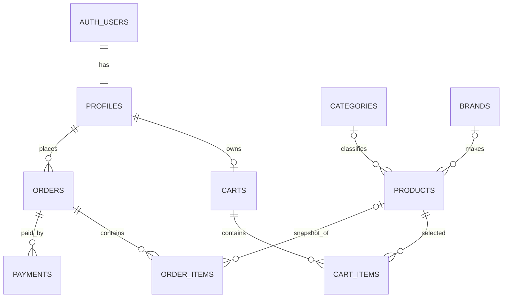

# Lensline — төслийн зорилго ба зураглал

## Шийдэх асуудал

Улаанбаатар дахь камер сонирхогч болон контент бүтээгчид хэрэгцээндээ тохирох камер, линз, дагалдах хэрэгслийг нэг дороос харьцуулахад хүндрэлтэй байж болно. Ангилал, үндсэн үзүүлэлт, үнэ, үлдэгдэл болон худалдан авалтын явцыг нэг дор харуулах дэлгүүрийн урсгал энэ асуудлыг шийдэхээр зорьж байна. Энэ нь төслийн асуудлын таамаглал бөгөөд хэрэглэгчийн судалгаагаар баталгаажуулсан зах зээлийн тоо баримт биш.

### Хэрэглэгчид

- **Худалдан авагч:** камерын төрлөөр шүүх, загварын үзүүлэлт ба үнийг харах, сагсанд хийх, захиалгаа хянах.
- **Дэлгүүрийн админ:** бүтээгдэхүүний мэдээлэл/зураг/үлдэгдлийг удирдах, захиалгын явцыг шинэчлэх.

### Хамрах хүрээ ба төлөв

- Бүтээгдэхүүн, брэнд, ангилал Supabase PostgreSQL-д хадгалагдана.
- Бүртгэл, нэвтрэлт Supabase Auth ашиглана. Email баталгаажуулалт асаалттай бол хэрэглэгч баталгаажуулсны дараа нэвтэрнэ.
- Сагс, profile, захиалга нь нэвтэрсэн хэрэглэгчийн Supabase өгөгдөлтэй холбогдоно.
- Checkout-ийн QR нь одоогоор **demo QR**: банкны төлбөрийн QR биш. “Mark demo payment complete” нь `demo_paid` гэсэн туршилтын төлөв хадгалдаг.
- QPay болон бодит төлбөрийн баталгаажуулалт хамрах хүрээнд ороогүй. Бодит мөнгөн гүйлгээ хийхээс өмнө merchant эрх, сервер талын invoice үүсгэлт, provider-оос төлбөр шалгалт шаардлагатай.

## Хэрэглэгчийн урсгал

### Худалдан авагч



### Админ



## Wireframe — бага нягтралтай бүтэц

Доорх нь компонент ба контентын байрлалыг тайлбарласан wireframe. Одоогийн CSS нь өнгө, зураг, typography-г хэрэгжүүлдэг; wireframe нь pixel-perfect загвар биш.

### Нүүр — desktop

```text
┌────────────────────────────────────────────────────────────────────┐
│ Logo       Home   Shop   Cameras   Accessories     Account   Bag    │
├───────────────────────────────┬────────────────────────────────────┤
│ Hero title + intro + CTA      │ Камерын editorial зураг            │
├───────────────────────────────┴────────────────────────────────────┤
│ Store introduction                                                │
├────────────────────────────────────────────────────────────────────┤
│ Featured gear                           View all                   │
│ [Product card] [Product card] [Product card] [Product card]       │
├────────────────────────────────────────────────────────────────────┤
│ Brand strip                                                        │
├────────────────────────────────────────────────────────────────────┤
│ Promotion / CTA                         Photographer image         │
├────────────────────────────────────────────────────────────────────┤
│ Footer: explore · customer care · store information               │
└────────────────────────────────────────────────────────────────────┘
```

### Нүүр — mobile

```text
┌──────────────────────────────┐
│ ☰  Logo                 Bag  │
├──────────────────────────────┤
│ Hero image                   │
│ Headline                     │
│ Short intro                  │
│ [Explore products]           │
├──────────────────────────────┤
│ Featured gear                │
│ [Card]          [Card]       │
│ [Card]          [Card]       │
├──────────────────────────────┤
│ Brands · promotion · footer  │
└──────────────────────────────┘
```

### Каталог ба дэлгэрэнгүй

```text
Catalog: title + intro
         [Search................................]
         [Category] [Brand] [Sort] [Count]
         [Product card] [Product card] ...

Product: [Back to collection]
         [Large product image] [Brand / category]
                              [Name + price]
                              [Description + stock]
                              [Add to bag]
                              [Specifications]
         [Related products]
```

### Сагс ба checkout

```text
Cart:     Product rows + quantity controls | Order summary + total
Checkout: Contact / delivery form           | Order summary + total
          Demo payment disclosure           | [Place order]
          After order: modal with demo QR, amount, explicit warning,
          [Mark demo payment complete] and [Pay later]
```

### Profile, захиалгын түүх, админ

```text
Profile:       Account details + editable name/phone + sign out
Orders:        Order ID/date/items/total + payment and fulfillment state
Admin:         Product/order/revenue summary + product CRUD + order status
```

## URL route-ууд

| URL | Дэлгэц | Хандалт |
|---|---|---|
| `/` | Нүүр | Нийтийн |
| `/shop` | Бүх бараа | Нийтийн |
| `/cameras` | Камерын ангиллууд | Нийтийн |
| `/accessories` | Линз, цүнх, tripod, дагалдах хэрэгсэл | Нийтийн |
| `/products/:productId` | Барааны дэлгэрэнгүй | Нийтийн |
| `/cart` | Хэрэглэгчийн сагс | Нэвтрэх шаардлагатай үйлдэлтэй |
| `/checkout` | Захиалга ба demo QR | Нэвтрэх шаардлагатай |
| `/orders` | Захиалгын түүх | Нэвтэрсэн хэрэглэгч |
| `/profile` | Profile | Нэвтэрсэн хэрэглэгч |
| `/admin` | Бараа ба захиалгын удирдлага | `admin` role |

## ERD



### Гол багана ба хязгаарлалтууд

| Хүснэгт | Түлхүүр багана / холбоос |
|---|---|
| `profiles` | `id` нь `auth.users.id`-тэй ижил UUID, `email` unique, `role` нь `customer/admin` |
| `categories` | UUID `id`, unique `name` |
| `brands` | UUID `id`, unique `name` |
| `products` | `price >= 0`, `stock >= 0`; `category_id`, `brand_id` nullable; үзүүлэлт `jsonb` |
| `carts` | `user_id` нь profile руу FK бөгөөд unique — хэрэглэгч бүрт нэг сагс |
| `cart_items` | cart болон product FK; quantity positive; `(cart_id, product_id)` unique |
| `orders` | profile FK; total nonnegative; shipping address `jsonb`; төлөвийн enum ба payment status |
| `order_items` | order FK; бүтээгдэхүүний нэр/үнэ захиалга үүсэх үед snapshot; `product_id` нь бараа устахад `NULL` болно |
| `payments` | order FK; дүн, арга, төлөв, transaction ID |

## RLS эрхийн хураангуй

| Өгөгдөл | Унших | Үүсгэх/өөрчлөх |
|---|---|---|
| `profiles` | Хэрэглэгч өөрийнх; админ dashboard-д бусдын profile-ийг уншиж болно | Хэрэглэгч зөвхөн өөрийн profile үүсгэнэ; зөвхөн нэр/утас засна; role ба ID-г клиент өөрчлөхгүй |
| `carts`, `cart_items` | Эзэмшигчийн сагс; админ дэмжлэгийн эрхтэй | Хэрэглэгч зөвхөн өөрийн сагсны мөрүүдийг удирдана; админ бүх сагсыг удирдах боломжтой |
| `orders`, `order_items`, `payments` | Захиалгын эзэн болон админ | Checkout RPC захиалга, мөр, payment үүсгэнэ; эзэмшигчийн demo-payment RPC зөвхөн өөрийн `DEMO` төлбөрийг `demo_paid` болгоно; админ fulfillment төлөв засна |
| `products`, `brands`, `categories` | Нийтийн каталог | Админ CRUD |
| `storage.objects` дахь `product-images` | Зураг нийтийн | Админ upload/update/delete |

Эдгээр бодлого migration файлд тодорхойлогдсон. Supabase project дээр migrations ажиллуулж байж remote орчинд үйлчилнэ.
